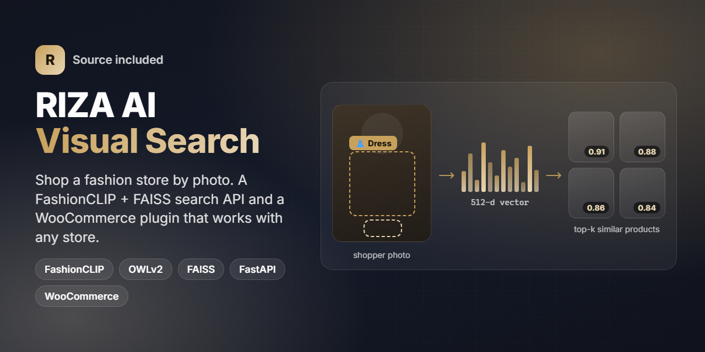
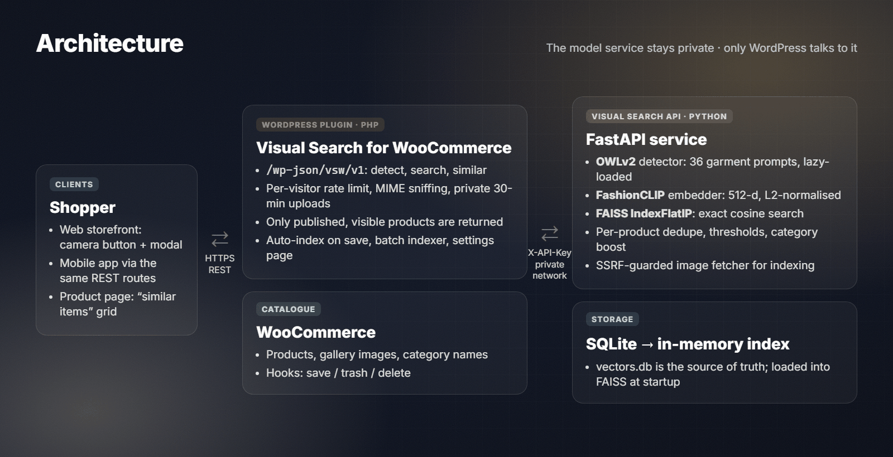
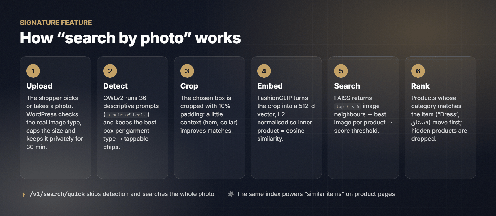
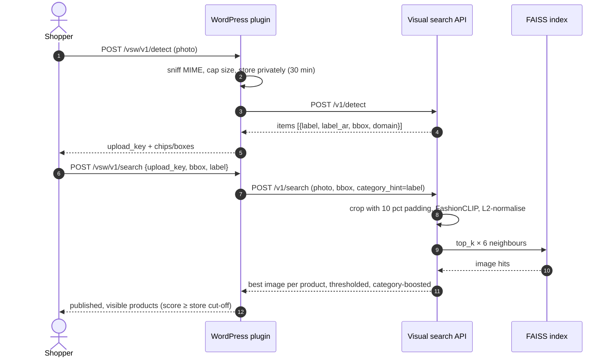
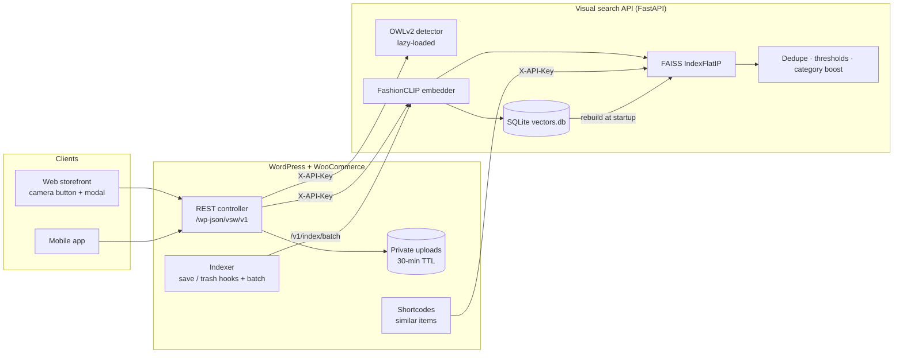

<p align="center"></p>
<h1 align="center">RIZA AI Visual Search</h1>
<p align="center"><b>Search a fashion store by photo. A FashionCLIP + FAISS search API and a WooCommerce plugin you can drop into any store.</b></p>
<p align="center">
  
  
  
  
  
  
  
  
  
</p>
<p align="center"><a href="https://play.google.com/store/apps/details?id=com.riza.store"></a> <a href="https://apps.apple.com/sa/app/riza-fashion-shopping/id6758075701"></a></p>

> This repository is a cleaned-up, store-agnostic rewrite of the visual search I built for the **RIZA** fashion store.
> It keeps the production algorithms and tuning but contains no store data, credentials or infrastructure details.

---

## Overview

RIZA is a fashion and lifestyle e-commerce brand that runs on WordPress + WooCommerce, with a companion mobile app.
Shoppers often arrive with a **picture** of something they like (a screenshot from social media, a photo from the street)
and no idea what it is called in the catalogue. I designed and built the feature that answers that question:
**"show me products that look like this."**

| | |
|---|---|
| **What** | Photo search ("shop the look") and "similar items" for a WooCommerce catalogue |
| **Who for** | Shoppers on the web storefront and the mobile app; store admins who keep the index in sync |
| **My role** | End-to-end: model selection, Python service, indexing pipeline, WordPress integration, REST endpoints for the app, deployment and tuning |
| **Timeline** | First production version in May 2026, then a memory-optimisation release |
| **This repo** | A rewrite of that work as two clean, reusable packages: `api/` (Python) and `wordpress-plugin/` (PHP) |

## The challenge

- **Text search fails for fashion.** Shoppers can't type "beige wrap midi dress with puff sleeves". They can show it.
- **Photos contain several products.** An outfit photo has a dress, shoes and a bag. Searching the whole image returns a mix.
- **CPU-only hosting.** The store ran on a server without a GPU, shared with the shop itself, so every model had to justify its RAM.
- **Catalogue churn.** Products and gallery images change daily, so the index has to update on save, without blocking the admin.
- **Public, anonymous endpoint.** Anyone can upload an image, so uploads, rate limits and what the API returns all need hard limits.

## Highlights

**🔍 Search**
- Garment **detection** with OWLv2 using 36 descriptive prompts (dresses, abayas, heels, bags, perfume, toys…), so each item becomes a tappable chip with its bounding box
- **Region search**: the selected box is cropped with 10 % padding and embedded with **FashionCLIP**
- **Quick search** endpoint that skips detection for an instant whole-image search
- **"Similar items"** for any product, built from the mean of its image embeddings and shown with a shortcode or automatically on product pages

**🎯 Ranking quality**
- Exact cosine search (FAISS `IndexFlatIP` on L2-normalised vectors)
- **Per-product de-duplication**: fetch `top_k × 6` image neighbours and keep the best image per product
- Two thresholds: a loose one in the API for recall, a stricter cut-off in the store for precision
- **Category boost**: products whose category matches the detected item ("Dress" / "فستان") are moved to the top

**🧩 Integration**
- WordPress plugin with a Settings API page, a batch indexer, auto-indexing on product save/trash, shortcodes and theme-overridable templates
- Public REST routes (`/wp-json/vsw/v1/*`) shared by the web widget and the mobile app
- Catalogue indexer CLI for **CSV, JSON or the WooCommerce REST API**

**🛡️ Safety**
- API-key auth, upload size and pixel limits, real MIME sniffing, private 30-minute uploads, per-visitor rate limiting, and an SSRF-guarded image fetcher

## Screens

There are no UI screenshots here. The storefront widget is a theme-styled modal and I did not have clean public captures of it,
so the visuals below are **diagrams**, not app screens.

<p align="center"></p>
<p align="center"><sub>The shopper only ever talks to WordPress. The model service lives on a private network behind an API key.</sub></p>

## Signature feature: search by photo

<p align="center"></p>



## Architecture & stack



| Layer | Tech | Where |
|---|---|---|
| Detection | OWLv2 (`google/owlv2-base-patch16-finetuned`), open-vocabulary prompts | `api/app/models/detector.py`, `vocabulary.py` |
| Embeddings | FashionCLIP (`patrickjohncyh/fashion-clip`), 512-d, L2-normalised | `api/app/models/embedder.py` |
| Vector search | FAISS `IndexFlatIP` (NumPy fallback) | `api/app/index/vector_index.py` |
| Persistence | SQLite (one row per product image, upsert) | `api/app/index/store.py` |
| Ranking | Per-product dedupe, thresholds, category boost/filter | `api/app/services/` |
| HTTP API | FastAPI + Pydantic v2, pydantic-settings | `api/app/api/`, `api/app/schemas/` |
| Catalogue import | CSV / JSON / WooCommerce REST (httpx) | `api/app/catalog/`, `api/scripts/` |
| Store integration | WordPress plugin (PHP 7.4+), WP REST API, Settings API, transients, WP-Cron | `wordpress-plugin/` |
| Storefront UI | Vanilla JS + CSS custom properties | `wordpress-plugin/.../assets/` |

## Engineering notes

1. **Fitting three models into a CPU box, then dropping one.** The first release loaded OWLv2, FashionCLIP *and* a
   general-purpose CLIP for non-fashion items. Measurements showed FashionCLIP handled beauty, fragrance and toys well
   enough, so the general model was removed (about 1.8 GB of RAM saved). The `domain` flag survived as a stricter
   threshold for non-fashion items (`0.22` vs `0.20`).
2. **Lazy detector.** OWLv2 is the heaviest model (about 2.5 GB in RAM) and only `/detect` needs it. It now loads behind a
   double-checked lock on first use, or warms up in a background thread after startup, so `/search` is ready immediately.
3. **One hit per product.** Products have several gallery images, so raw nearest neighbours are dominated by a few products.
   The index oversamples (`top_k × 6`), keeps the best image per product and only then applies `top_k`. The store
   requests `max(top_k × 4, 48)` because some hits are removed later (drafts, hidden products, the store score cut-off).
4. **Category-aware re-ranking.** A beige bag can look closer to a beige dress than another dress does. A stable
   partition ("matching category first, score order inside each group") fixed this without retraining. It works with
   Arabic category names too.
5. **Correct boxes on non-square photos.** OWLv2 pads inputs to a square, so the rewrite post-processes against the
   padded size. Boxes then line up with the original pixels and the storefront can draw them in percentages over a
   responsive image.
6. **SQLite as source of truth.** Vectors are upserted per `(product_id, image_url)` and the in-memory FAISS index is
   rebuilt at startup and after deletes. Re-indexing is idempotent and a restart never loses the index.

## Results

From the project's deployment notes (May 2026):

- **11,934 product images** from **2,697 products** were indexed and searchable in production.
- The memory-optimisation release cut the service's resident memory from **about 6 GB to about 2 GB** by merging the two CLIP models
  and lazy-loading the detector. It runs on CPU only, with no GPU.
- The same REST endpoints served both the web storefront and the mobile app.

No conversion or traffic metrics are claimed here.

---

## Getting started

### 1. Visual search API

```bash
cd api
python -m venv .venv && source .venv/bin/activate      # Windows: .venv\Scripts\activate
pip install -r requirements.txt                         # installs torch (CPU wheels are fine)
cp .env.example .env                                    # set VS_API_KEY at least
make run                                                # uvicorn on 127.0.0.1:8000
```

On first start, the models download from Hugging Face (FashionCLIP is about 600 MB and OWLv2 about 600 MB on disk).
With Docker:

```bash
make docker-build && make docker-run    # binds to 127.0.0.1:8000, caches models in a volume
```

### 2. Index a catalogue

```bash
# from a file (see api/examples/)
python -m scripts.index_catalog csv examples/catalog.sample.csv --api http://127.0.0.1:8000

# straight from WooCommerce (create a READ-ONLY REST key)
export WC_STORE_URL=https://shop.example.com WC_CONSUMER_KEY=ck_... WC_CONSUMER_SECRET=cs_... VS_API_KEY=...
python -m scripts.index_catalog woocommerce --api http://127.0.0.1:8000
```

### 3. WordPress plugin

1. Copy `wordpress-plugin/visual-search-for-woocommerce/` to `wp-content/plugins/` and activate it.
2. Open **WooCommerce → Visual Search**, enter the API URL and key, then click **Start indexing**.
3. Turn on the camera button in the product search form, or place `[vsw_visual_search]` anywhere.
   Add `[vsw_similar_products]` on product pages, or turn on the automatic "similar items" section.

### Tests

```bash
cd api
pip install -r requirements-dev.txt     # no torch needed: tests use a fake embedder
python -m pytest                        # 42 tests (FAISS + NumPy backends)
```

## Project structure

```
riza-ai-visual-search/
├── api/                                   # Python visual search service
│   ├── app/
│   │   ├── core/        config.py (pydantic-settings) · security.py (X-API-Key) · logging.py
│   │   ├── models/      embedder.py (FashionCLIP) · detector.py (OWLv2, lazy) · vocabulary.py
│   │   ├── index/       store.py (SQLite) · vector_index.py (FAISS / NumPy)
│   │   ├── services/    search_service.py · indexing_service.py · rerank.py · images.py · container.py
│   │   ├── catalog/     sources.py (CSV, JSON, WooCommerce REST)
│   │   ├── schemas/     Pydantic request/response models
│   │   ├── api/routes/  health.py · search.py · indexing.py
│   │   └── main.py      app factory + lifespan
│   ├── scripts/index_catalog.py
│   ├── tests/           42 pytest tests, models mocked
│   ├── examples/        sample catalogue files
│   ├── Dockerfile · Makefile · .env.example · requirements*.txt · pyproject.toml
├── wordpress-plugin/visual-search-for-woocommerce/
│   ├── visual-search-for-woocommerce.php  # bootstrap
│   ├── includes/        plugin · settings · api-client · upload-store · rest-controller
│   │                    indexer · shortcodes · product-presenter
│   ├── templates/       button.php · modal.php · similar-products.php (theme-overridable)
│   ├── assets/          js/visual-search.js · js/admin.js · css/visual-search.css
│   └── uninstall.php · readme.txt
└── assets/              README images (+ _src/ with the render config)
```

## State & data flow

The service has no session state. Everything lives in a few places:

| State | Where | Lifetime |
|---|---|---|
| Image vectors + categories | SQLite `vectors.db` | Permanent; upserted per `(product_id, image_url)` |
| Search index | FAISS in memory | Rebuilt from SQLite at startup, after deletes and on `/v1/index/rebuild` |
| Detector weights | Process memory | Loaded on first `/detect` (or warmed in the background) |
| Shopper photo | `uploads/vsw-tmp/<random 32-char key>.<ext>` + transient | 30 minutes, removed hourly by WP-Cron |
| Similar-items results | Transient per product | 12 h (10 min after an API error). Visibility is re-checked on every render |
| Rate-limit counter | Transient per hashed IP | 5-minute window |

## Configuration

All API settings are environment variables with the `VS_` prefix. See [`api/.env.example`](api/.env.example).

| Variable | Default | Purpose |
|---|---|---|
| `VS_API_KEY` | *(empty)* | Required in `X-API-Key`. Empty disables auth; only acceptable on localhost |
| `VS_EMBEDDING_MODEL` | `patrickjohncyh/fashion-clip` | Any CLIP checkpoint with `get_image_features` |
| `VS_DETECTOR_MODEL` | `google/owlv2-base-patch16-finetuned` | OWLv2 checkpoint |
| `VS_PRELOAD_DETECTOR` | `true` | Warm the detector in the background after startup |
| `VS_DATA_DIR` | `./data` | Location of `vectors.db` |
| `VS_MIN_SCORE_FASHION` / `VS_MIN_SCORE_GENERAL` | `0.20` / `0.22` | API similarity thresholds per domain |
| `VS_DETECT_THRESHOLD` | `0.22` | OWLv2 box confidence |
| `VS_OVERSAMPLE` | `6` | Image neighbours fetched per requested product |
| `VS_MAX_UPLOAD_MB` | `10` | Upload / download size cap |
| `VS_ALLOWED_IMAGE_HOSTS` | *(empty)* | Allow-list for indexing URLs (recommended: your media host) |

Plugin settings (WooCommerce → Visual Search): API URL, API key (write-only), results per search, storefront score cut-off
(default `0.30`), search-form button, similar items on product pages, similar items count, auto-index on save, and searches
per visitor per 5 minutes.

## API reference

Interactive docs are served at `/docs` (Swagger) and `/redoc`. Every `/v1/*` route needs `X-API-Key`.

| Method | Path | Purpose |
|---|---|---|
| `GET` | `/health` | Liveness + model/index status (public, no catalogue data) |
| `POST` | `/v1/detect` | Detect shoppable items in a photo |
| `POST` | `/v1/search` | Similar products for a photo or a region of it |
| `POST` | `/v1/search/quick` | Whole-image search, no detection |
| `GET` | `/v1/products/{id}/similar` | "More like this" for an indexed product |
| `POST` | `/v1/index` | Index one image URL |
| `POST` | `/v1/index/batch` | Index up to 200 image URLs, with a result per item |
| `DELETE` | `/v1/index/products/{id}` | Remove a product's vectors |
| `POST` | `/v1/index/rebuild` | Rebuild the in-memory index from SQLite |
| `GET` | `/v1/index/stats` | Counts per store and backend |

<details>
<summary><b>POST /v1/detect</b></summary>

```bash
curl -s -H "X-API-Key: $VS_API_KEY" -F image=@outfit.jpg http://127.0.0.1:8000/v1/detect
```
```json
{
  "items": [
    {"label": "Dress", "label_ar": "فستان", "icon": "👗", "prompt": "a woman wearing a dress",
     "domain": "fashion", "bbox": [112.0, 40.5, 388.2, 610.0], "score": 0.512},
    {"label": "Heels", "label_ar": "هيلز", "icon": "👠", "prompt": "a pair of heels",
     "domain": "fashion", "bbox": [170.3, 640.0, 330.9, 780.4], "score": 0.341}
  ],
  "image_size": [600, 800]
}
```
If nothing is detected, a single `"Product"` item covering the whole image is returned, so the UI always has something to search.
</details>

<details>
<summary><b>POST /v1/search</b></summary>

Form fields: `image` (file), `bbox` (JSON `[x1,y1,x2,y2]`, optional), `top_k` (default 12), `domain` (`fashion` | `general`),
`min_score` (optional override), `category_hint` (comma-separated, used for ranking), `categories` (comma-separated, used as a hard filter).

```bash
curl -s -H "X-API-Key: $VS_API_KEY" -F image=@outfit.jpg \
     -F 'bbox=[112,40.5,388.2,610]' -F top_k=8 -F category_hint=Dress \
     http://127.0.0.1:8000/v1/search
```
```json
{
  "results": [
    {"product_id": 1042, "score": 0.8731, "image_url": "https://shop.example.com/media/1042-front.jpg", "categories": ["Women", "Dresses"]},
    {"product_id": 977,  "score": 0.8412, "image_url": "https://shop.example.com/media/977-side.jpg",  "categories": ["Women", "Dresses"]}
  ],
  "total_indexed": 11934,
  "domain": "fashion",
  "min_score_used": 0.2
}
```
</details>

<details>
<summary><b>GET /v1/products/{id}/similar</b></summary>

```bash
curl -s -H "X-API-Key: $VS_API_KEY" "http://127.0.0.1:8000/v1/products/1042/similar?top_k=8&category_hint=Dresses"
```
The response has the same shape as `/v1/search`. The product itself is excluded. Returns `404` if the product has no vectors.
</details>

<details>
<summary><b>POST /v1/index/batch</b></summary>

```bash
curl -s -H "X-API-Key: $VS_API_KEY" -H "Content-Type: application/json" http://127.0.0.1:8000/v1/index/batch -d '{
  "items": [
    {"product_id": 1042, "image_url": "https://shop.example.com/media/1042-front.jpg", "categories": ["Women", "Dresses"]},
    {"product_id": 1042, "image_url": "https://shop.example.com/media/1042-back.jpg",  "categories": ["Women", "Dresses"]}
  ]}'
```
```json
{"indexed": 2, "failed": 0, "total_indexed": 11936,
 "results": [{"product_id": 1042, "image_url": "https://shop.example.com/media/1042-front.jpg", "ok": true, "error": null}, "…"]}
```
</details>

**Storefront routes (WordPress plugin)**: `POST /wp-json/vsw/v1/detect` (multipart `image`) returns `{upload_key, image_size, items}`.
`POST /wp-json/vsw/v1/search` (`{upload_key, bbox, domain, label, label_ar}`) returns `{products: [{id, name, url, image, price_html, on_sale, in_stock, score}]}`.
`GET /wp-json/vsw/v1/similar/{id}` returns `{products}`.

## How indexing works

1. **Collect.** For each published product, the plugin (or the CLI) collects up to 5 images (main + gallery, `woocommerce_single` size) and the product's category names.
2. **Fetch safely.** The API downloads each URL with a size cap, no redirects, and a check that the host is public (or on `VS_ALLOWED_IMAGE_HOSTS`).
3. **Embed.** FashionCLIP produces a 512-d vector, which is L2-normalised.
4. **Persist.** The vector is upserted into SQLite by `(product_id, image_url)` and appended to the in-memory FAISS index, so it is searchable immediately.
5. **Keep in sync.** Saving a product sends a non-blocking batch. Trashing or deleting a product removes its vectors.
   The admin **Start indexing** button walks the catalogue 5 products per request (safe on shared hosting) and rebuilds the index at the end.

## Performance notes

- **Exact search is enough at this scale.** About 12k vectors × 512 floats is roughly 24 MB. A flat inner-product scan takes
  milliseconds on CPU and needs no training, so IVF/HNSW would only add tuning work.
- **Inference dominates latency.** The FashionCLIP forward pass and (on `/detect`) OWLv2 cost far more than FAISS. Handlers are
  sync `def`, so FastAPI runs them in its thread pool and the event loop stays free.
- **One worker per box.** Each Uvicorn worker loads its own copy of the models, so scale with more instances, not more workers.
- **Memory.** In production, merging the two CLIP models saved about 1.8 GB and lazy-loading OWLv2 saved about 2.5 GB while idle (from the deployment notes).
- **Cache what is stable.** "Similar items" for a product page are cached for 12 hours in a transient. Only product IDs are cached,
  so price, stock and visibility are always fresh.

No benchmark numbers are claimed beyond the above.

## Security notes

- **Private model service.** Bind the API to localhost or a private network. Only WordPress calls it, with `X-API-Key` (compared in constant time).
- **Uploads.** WordPress checks the real image type (`getimagesize` + `wp_check_filetype_and_ext`), enforces 10 MB, stores files
  under a random 32-character key in a directory that denies web access, and deletes them after 30 minutes. The API also enforces a
  byte limit and a pixel limit (to block decompression bombs).
- **Abuse.** Anonymous routes are rate-limited per hashed IP. Batch sizes and `top_k` are capped.
- **SSRF.** Indexing URLs must be `http(s)`, must not redirect, and must resolve to public IPs, or match an explicit allow-list.
- **Data exposure.** `/health` exposes no catalogue data, and visitors only ever receive published, visible products.
  API errors reach visitors as generic messages; details go to server logs.
- **Admin.** The settings page and batch indexer require `manage_woocommerce` and a nonce. All settings are sanitised and clamped,
  output is escaped, and the API key is write-only (never printed back into HTML).
- **WooCommerce credentials.** The CLI uses a read-only REST key sent with HTTP Basic auth over HTTPS only, never in query strings.

## Contributing

Issues and PRs are welcome. Before opening a PR, run:

```bash
cd api && ruff check app scripts tests && python -m pytest
find wordpress-plugin -name "*.php" -exec php -l {} \;
```

Keep the API free of store-specific logic. Anything specific to one store belongs in the plugin settings or a theme template override.

## License

[MIT](LICENSE) © Mahmoud Shaker

## بالعربي

**بحث بالصورة لمتجر RIZA للأزياء**: يرفع العميل صورة لإطلالة، فيكتشف النظام قطعها (فستان، حذاء، حقيبة…) باستخدام OWLv2،
ثم يحوّل القطعة المختارة إلى متجه بنموذج FashionCLIP ويبحث عن أقرب المنتجات عبر FAISS.
بعد ذلك يرتّب النتائج بحيث تتصدّر المنتجات التي تطابق فئة القطعة.
بنيتُ المشروع كاملاً: خدمة Python (FastAPI) وإضافة WordPress/WooCommerce وواجهات REST يستخدمها الموقع والتطبيق.
في الإنتاج غطّى الفهرس 11,934 صورة لـ 2,697 منتجاً، على سيرفر بدون GPU، بعد خفض استهلاك الذاكرة من نحو 6 إلى نحو 2 جيجابايت.
هذا المستودع إعادة كتابة نظيفة وعامة تصلح لأي متجر WooCommerce، ولا يحتوي على أي بيانات أو مفاتيح خاصة بالمتجر.

## Links

- RIZA store app — Google Play: <https://play.google.com/store/apps/details?id=com.riza.store>
- RIZA store app — App Store: <https://apps.apple.com/sa/app/riza-fashion-shopping/id6758075701>
- FashionCLIP model: <https://huggingface.co/patrickjohncyh/fashion-clip>
- OWLv2: <https://huggingface.co/google/owlv2-base-patch16-finetuned>
- FAISS: <https://github.com/facebookresearch/faiss>
- More of my work: <https://anashaker.github.io/shaker_portfolio/>

---
<h3 align="center">Built by Mahmoud Shaker — Senior Flutter Engineer</h3>
<p align="center">
  <a href="https://wa.me/201140279111"></a>
  <a href="https://www.linkedin.com/in/anashaker/"></a>
  <a href="https://anashaker.github.io/shaker_portfolio/"></a>
  <a href="mailto:mahmoudshaker382001@gmail.com"></a>
  <a href="https://khamsat.com/user/sheko201566"></a>
  <a href="https://mostaql.com/u/ShekoShaker"></a>
  <a href="https://github.com/ANaSHaker"></a>
</p>
